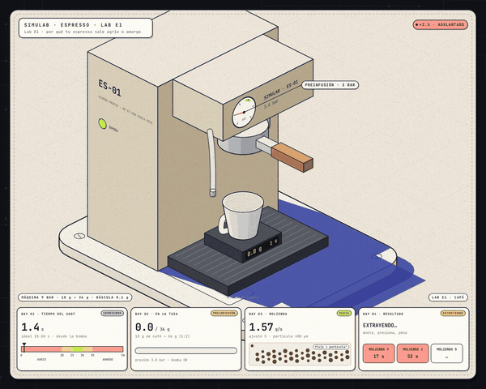
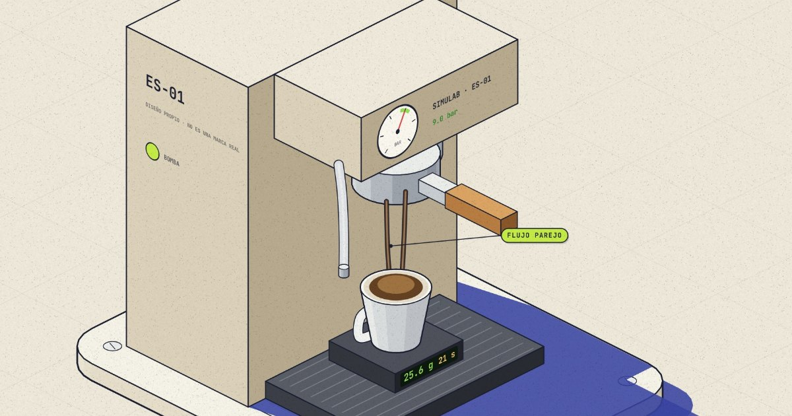
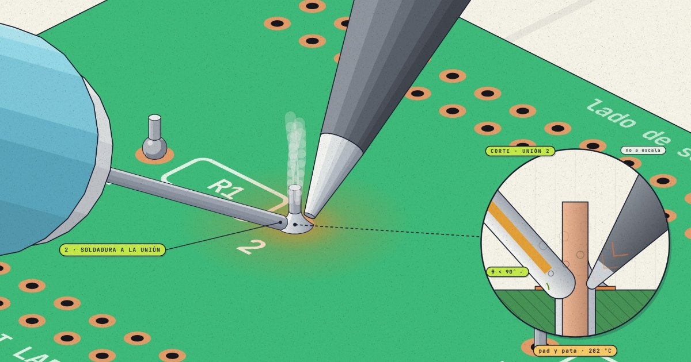
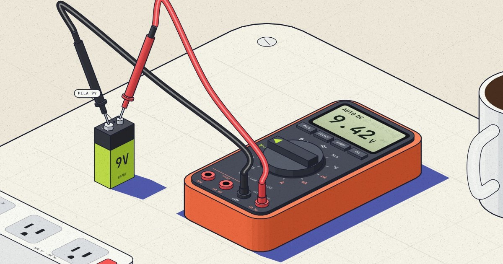
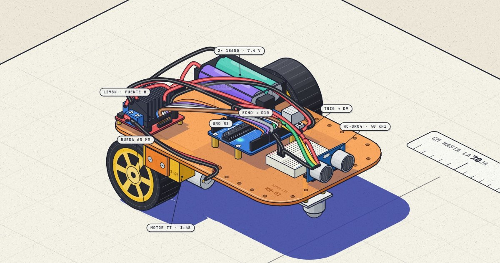
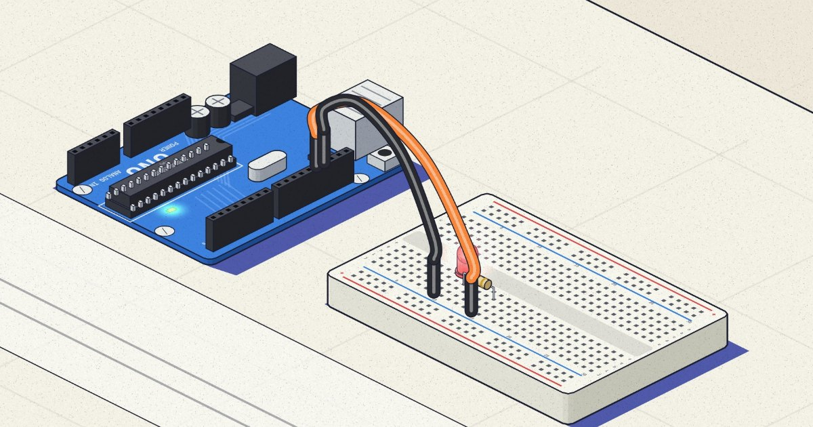

# SIMULAB

Claude Code 技能，可將任何領域的想法轉化為互動式 3D 實驗室：自動生成單一 HTML 頁面，分章節說明，接著讓你動手操作、看看會發生什麼事。畫面上的每個數值都來自有資料來源的模型。同一份程式碼也能輸出含音訊、每秒 60 格的影片。



| 咖啡 | 焊接 | 三用電表 |
|---|---|---|
|  |  |  |
| **機器人** | **程式設計** | |
|  |  | |

## 安裝

```
npx skills add ecapri-dev/simulab-skill -g -a claude-code
```

接著在安裝目錄中執行一次：

```
cd ~/.claude/skills/simulab && npm install && pip install -r requirements.txt && npx playwright install chromium
```

你需要 Node.js 20 或更新版本、Python 3 和 Chrome。若要輸出影片，還需要 `ffmpeg`。

## 使用方式

用自己的話提出需求：

> /simulab 做一個說明釣魚時魚線為什麼會斷的實驗室，並把捲線器的煞車做成旋鈕。

> /simulab 做一個說明複利為什麼重要的實驗室：硬幣投入罐子，並比較提早 5 年開始的差異。

> /simulab 做一個說明如何組裝電腦的實驗室，讓每個零件自動就位，並加入練習模式。

[PROMPTS.md](PROMPTS.md) 中提供逐步引導的提示詞。

開啟範例：

```
node tools/build.mjs demos/labE1-espresso    # -> demos/labE1-espresso/dist/index.html
```

## 九個步驟

1. 將想法化為一個問題，並包含一個會移動的物件和一個數值。
2. 繪製前先找好數值來源；其餘內容標示為假設。
3. 先建立模型：使用單一輸入的純函式。
4. 物件取自素材庫；缺少的物件只新增一次。
5. 透過對比安排章節：錯誤、正確、過度。
6. 讓使用者試著弄壞它：提供一個旋鈕和一個按鍵。
7. 使用接觸表檢視，不憑記憶判斷。
8. 先預覽，再輸出最終影片。
9. 所有內容整合成一個小於 1 MB 的檔案。

詳細說明請參閱 [SKILL.md](SKILL.md)。

## 專案內容

| | |
|---|---|
| `SKILL.md` | Claude 會讀取的內容：方法、每個實驗室的規範與檢查方式。 |
| `PROMPTS.md` | 西班牙文和英文提示詞，以及依領域分類的點子清單。 |
| `kit/` | 等角投影引擎、介面、播放器和語言檔。 |
| `assets/` | 44 個可重複使用的物件（電路板、工具、咖啡等）。清單請見 `CATALOGO.md`。 |
| `demos/` | 5 個完整實驗室和素材目錄。 |
| `tools/` | 建置、接觸表、影片、音訊和封面工具。 |

## 致謝

由 [@0xKapri](https://x.com/0xKapri) 使用自己的 KAPRI LAB 素材組製作。字型採用 SIL 開放字型授權（`kit/fonts/`）。

MIT 授權。
